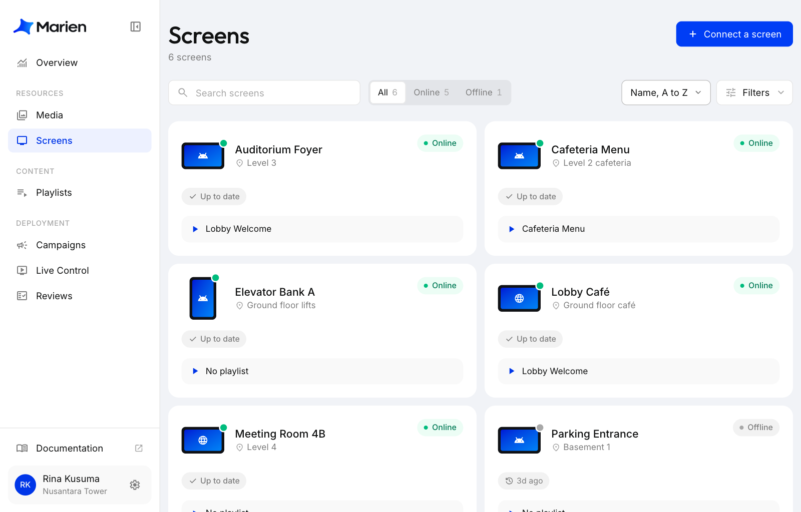
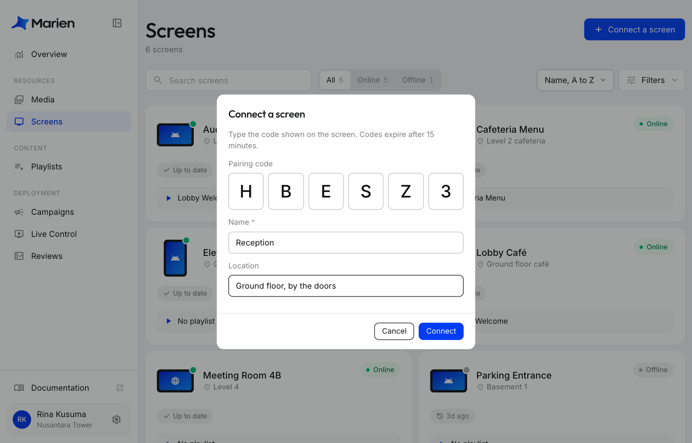
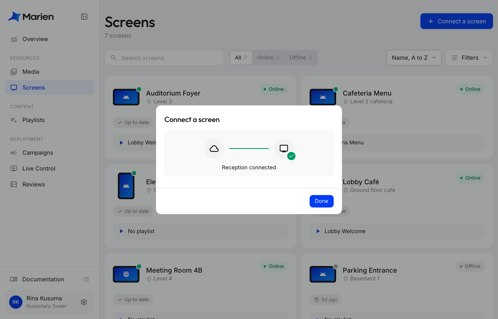
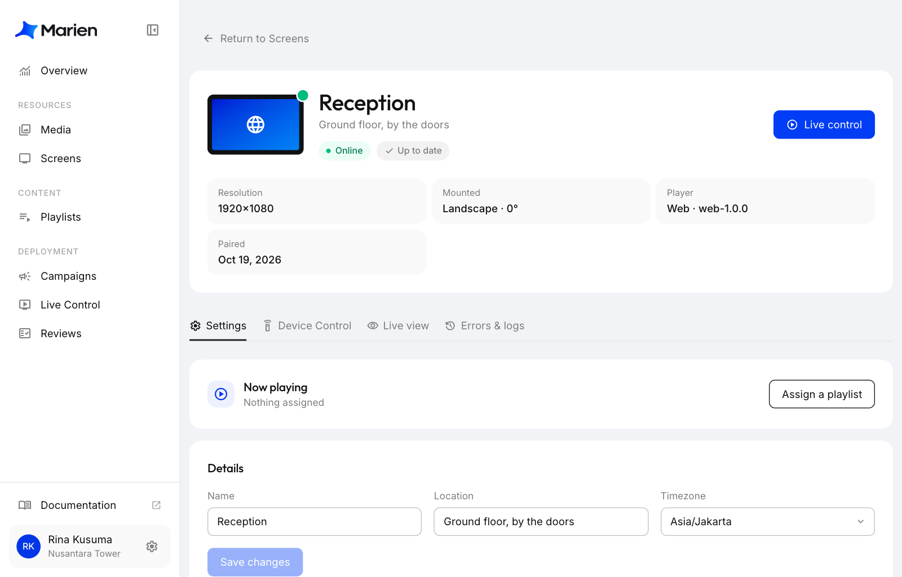

# Hubungkan Layar

Layar harus sedang menampilkan kode pairing. Lihat [Siapkan Perangkat](setting-up-your-device.md).

**1.** Di Marien CMS, buka **Screens** lalu klik **Connect a screen**.

**2.** Ketik kode dari layar, nama layar, dan (kalau mau) lokasinya. Klik **Connect**.

**3.** Tunggu beberapa detik sampai muncul tulisan bahwa layar sudah terhubung, lalu klik **Done**.

**4.** Selesai. Kamu langsung dibawa ke halaman layar tersebut. Supaya layar memutar sesuatu, [buat playlist](creating-a-playlist.md), lalu [buat campaign](creating-a-campaign.md) untuk menayangkannya di layar.

!!! tip
    Kode berlaku selama 15 menit. Setelah itu layar menampilkan kode baru dengan sendirinya. Kalau layar dipasang tegak (portrait) atau terbalik, ubah di halaman layar lewat **Device Control**, lalu **Rotation**.
