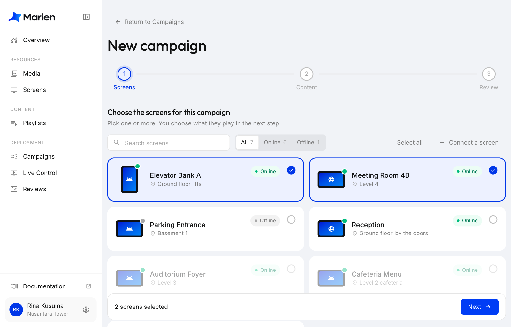
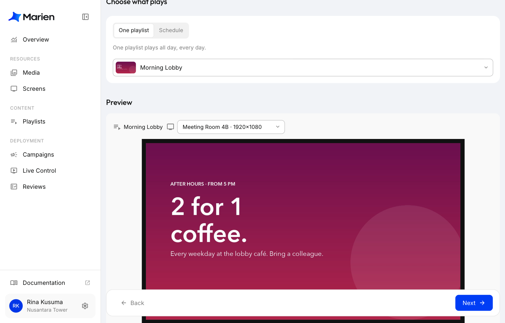
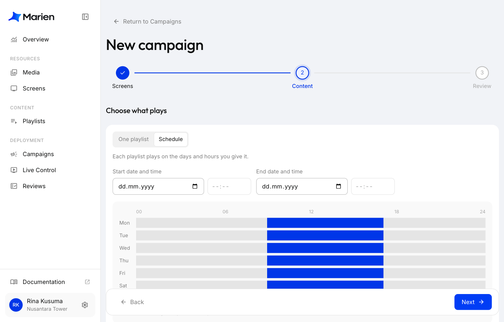
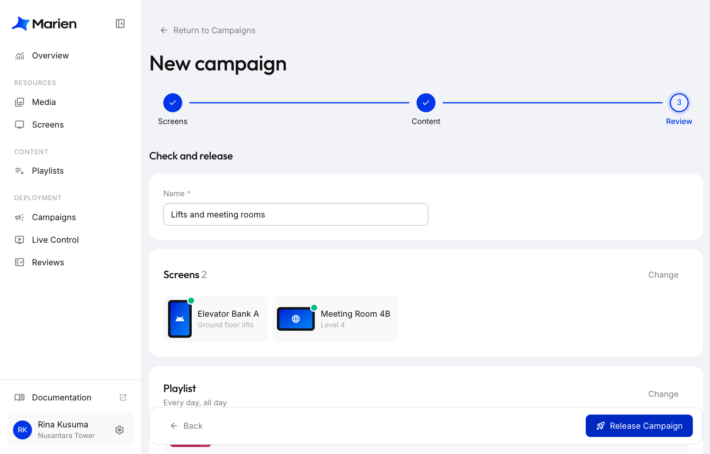

# Buat Campaign

Campaign menayangkan playlist di layar: terus-menerus, atau sesuai jadwal.

**1.** Di Marien CMS, buka **Campaigns** lalu klik **New campaign**. Pilih layarnya, lalu klik **Next**.

!!! note
    Satu layar hanya bisa ada di satu campaign pada satu waktu. Layar yang berwarna abu-abu sudah ada di campaign lain: ubah campaign itu saja.

**2.** Pilih apa yang diputar:

- **One playlist**: pilih satu playlist untuk diputar seharian, setiap hari.
- **Schedule**: tambahkan satu playlist untuk tiap rentang waktu (jam dan hari). Kamu juga bisa menentukan tanggal mulai dan tanggal selesai.

Klik **Next**.

**3.** Beri nama campaign, periksa pengaturannya, lalu klik **Release Campaign**, dan klik **Release Campaign** sekali lagi untuk konfirmasi.

**4.** Selesai. Layar mulai memutar tayangan dalam beberapa detik.

Untuk mengubahnya nanti, buka campaign dari **Campaigns**, ubah isinya, lalu klik **Save & Apply**.

!!! note "Pakai sub-account?"
    Kotak konfirmasinya bertuliskan **Send for review**. Layar tidak berubah sampai owner menyetujuinya. Lihat [Cara Kerja Review](how-reviews-work.md).
