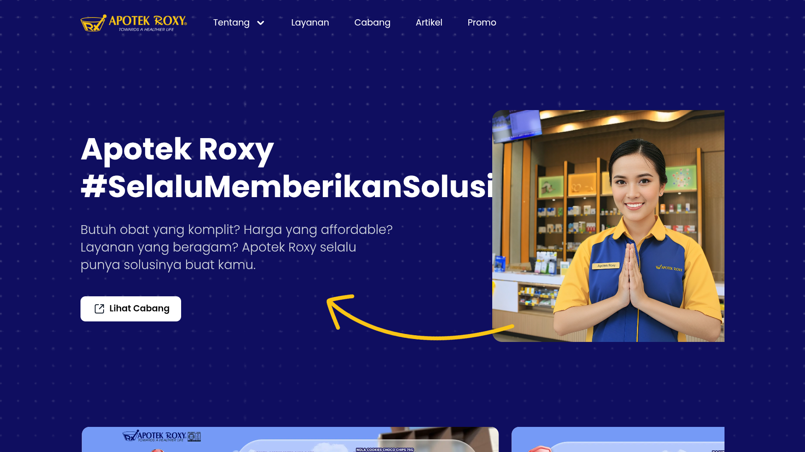

# Perbarui WebView

Website di layar digambar oleh **WebView** milik perangkat. Kalau WebView-nya terlalu lama, website modern tampil rusak. Halaman ini memperbarui WebView dari komputer lewat adb, tanpa Play Store dan tanpa memasukkan akun Google di perangkat.

Lakukan ini untuk setiap layar Android **sebelum dikirim**, kalau layar itu akan menampilkan website.

## Kenapa penting

Website yang dibuat dengan teknologi baru (misalnya Tailwind v4) butuh **WebView versi 111 ke atas**. Di WebView yang lebih lama, tampilannya seperti tanpa CSS: gambar membesar, tata letak berantakan, dan ada kotak abu-abu menutupi layar. Website yang sama tampil normal di WebView 155.

Website yang sama di panel yang sama:

| WebView 91 (terlalu lama) | WebView 155 (aman) |
|---|---|
|  |  |

!!! warning "Banyak panel punya dua WebView"
    Satu panel bisa punya WebView lama dan baru sekaligus. Memasang yang baru saja belum cukup: pastikan **yang baru yang dipakai** (langkah 5).

## Sebelum mulai

- Komputer dengan adb (alat untuk mengatur perangkat Android dari komputer): `brew install --cask android-platform-tools`
- Perangkat dan komputer di Wi-Fi yang sama, atau pakai kabel USB.
- File `.apk` WebView yang cocok dengan perangkat (langkah 3).

## Langkah-langkah

1. Sambungkan ke perangkat. Wi-Fi yang sama:
    ```bash
    adb connect <device-ip>:5555
    ```
    Kalau gagal, atau perangkat Android 11 ke atas, ikuti langkah 2 di [Device Owner lewat Wi-Fi](remote-device-owner-setup.md).
2. Cek WebView mana yang dipakai dan versinya:
    ```bash
    adb shell dumpsys webviewupdate
    ```
    Lihat baris **Current WebView package**. Isinya nama paket dan versi, misalnya `com.google.android.webview, 91.0.4472.114`.
    - **111 atau lebih tinggi:** tidak perlu apa-apa. Selesai.
    - **Di bawah 111:** lanjut.
3. Siapkan file yang tepat. Tanya perangkatnya:
    ```bash
    adb shell getprop ro.product.cpu.abi
    adb shell getprop ro.build.version.release
    ```
    Unduh **Android System WebView** yang cocok dengan kedua jawaban itu (`arm64-v8a` atau `armeabi-v7a`, dan versi Android-nya) dari sumber yang dipercaya tim, misalnya APKMirror. Pilih build terbaru yang masih mendukung versi Android perangkat.
    !!! note
        Sebagian build juga minta **Trichrome Library**. Pasang itu lebih dulu. File `.apkm` atau `.xapk` adalah paket gabungan: ekstrak, lalu pakai `adb install-multiple -r *.apk`.
4. Pasang. Tanda `-r` menjaga aplikasi dan pengaturan yang sudah ada:
    ```bash
    adb install -r android-system-webview.apk
    ```
    Harusnya muncul `Success`.
5. Jadikan WebView yang baru sebagai yang aktif:
    ```bash
    adb shell cmd webviewupdate set-webview-implementation com.google.android.webview
    ```
    Kalau muncul pesan paket tidak valid, atur langsung di perangkat: **Settings → Developer options → WebView implementation**, lalu pilih yang baru.
6. Cek lagi. Versinya sekarang harus 111 ke atas:
    ```bash
    adb shell dumpsys webviewupdate
    ```
7. Mulai ulang player supaya memakai WebView yang baru:
    ```bash
    adb shell am force-stop com.fortu.player
    adb shell monkey -p com.fortu.player -c android.intent.category.LAUNCHER 1
    ```
8. Tes dengan website sungguhan. Tambahkan item **Website** ke playlist seperti di [Buat Playlist](creating-a-playlist.md), lalu putar di layar ini. Tampilannya harus sama seperti di browser biasa.

## Kalau tidak berhasil

| Yang muncul | Yang dilakukan |
|---|---|
| `INSTALL_FAILED_VERSION_DOWNGRADE` | File lebih lama dari yang terpasang. Unduh build yang lebih baru. |
| `INSTALL_FAILED_OLDER_SDK` | File butuh Android yang lebih baru. Pilih build untuk versi Android perangkat. |
| `INSTALL_FAILED_UPDATE_INCOMPATIBLE` | Yang terpasang ditandatangani dengan cara berbeda. Pilih build Google untuk paket yang mau diganti, atau pakai nama paket yang satunya. |
| Versi masih lama setelah langkah 6 | WebView lama masih aktif. Ulangi langkah 5 lewat **Developer options**. Nyalakan ulang perangkat kalau perlu. |
| Website masih rusak | Buka website yang sama di Chrome pada layar yang sama. Kalau di sana juga rusak, masalahnya di websitenya, bukan di layar. |

!!! tip
    Catat versi akhirnya di daftar periksa perangkat yang diserahkan, misalnya "WebView 155 di com.google.android.webview".
